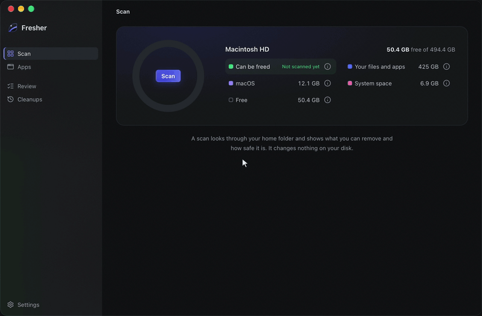

<p align="center">
  
</p>

<h1 align="center">Fresher</h1>

<p align="center">
  <b>Your Mac is full. See why.</b><br>
  A free, open-source disk cleaner for macOS, made with developers' Macs in mind. It explains every gigabyte in plain
  English, shows the risk of removing it, and removes nothing you have not confirmed.
</p>

<p align="center">
  <a href="https://github.com/AlexSergey/fresher/releases/latest"></a>
  
  
  
</p>

<p align="center">
  <a href="https://getfresher.app">getfresher.app</a> ·
  <a href="#why-fresher">Why Fresher</a> ·
  <a href="#install">Install</a> ·
  <a href="#what-it-finds">What it finds</a> ·
  <a href="#help-it-get-better">Help it get better</a>
</p>

<p align="center">
  <a href="https://github.com/AlexSergey/fresher/releases/latest"></a>
</p>

<p align="center">
  
</p>

> ⭐ **If Fresher gave you back some space, a [star](https://github.com/AlexSergey/fresher/stargazers) helps other
> people find it.** It takes one click.

## Why Fresher

I'm a developer on a Mac with 500 GB, and the disk kept filling up by itself: gigabytes vanished, removed apps left
their caches and settings behind, and tools I no longer used piled up. I made Fresher to see where the space goes and
take it back, safely.

- **Developer-first.** It knows where a developer's Mac fills up: Xcode's build data, previews and device files, old
  JetBrains IDE versions, the caches of npm, Yarn, Homebrew, Cargo, Gradle, CocoaPods, pip and Go, the packages and
  builds of projects untouched for a year, Rust and Node versions no project uses, and local AI models. For Docker it
  shows what each part takes and the command that frees it.
- **Private.** No network requests at all: no telemetry, no analytics, no crash reports, no update checks. What it
  scans and what it finds stay on your Mac ([how](docs/restrictions/privacy.md#no-network)).
- **Safe.** Nothing happens without you: opening the app starts no scan, and a scan only reads. Nothing is removed
  until you confirm the exact items, with their size and danger level, and each one is checked again right before it
  goes: anything that changed is skipped. System folders, other users' files and your home's own folders are never
  removed ([how](docs/restrictions/deletion-safety.md)).
- **Undoable.** Items go to the Trash, and the Cleanups screen puts them back. Deleting permanently is a separate choice
  you tick each time, and Fresher never empties the Trash for you
  ([how](docs/restrictions/deletion-safety.md#trash-first)).
- **Plain English.** Every kind of file has a name, a page saying what it is and what happens if it goes, and a danger
  level from "Safe to remove" to "Only if you are sure". There is no "Other": space it does not recognize is shown as
  its real folders.
- **Nothing in the background.** No helper, no login item, no scheduled scans: it works only while it is open
  ([why](docs/goal.md#8-transparent-it-does-only-what-the-user-asks)).

## Install

**[Download the latest `.dmg`](https://github.com/AlexSergey/fresher/releases/latest)**, open it and drag Fresher to
Applications. It runs on macOS 13 or later, on Apple silicon and Intel. What changed in each version: [the changelog](docs/changelog.md).

> **Get Fresher only from [getfresher.app](https://getfresher.app) or [this repository's releases](https://github.com/AlexSergey/fresher/releases).**
> It is free, and it never asks for your password or for administrator rights: a copy that asks for money or for a
> password is not Fresher.

### First launch on macOS

Fresher 0.1.0 is not signed with an Apple Developer ID or notarized yet, so macOS blocks the first launch of a
downloaded copy.

1. Move Fresher.app to Applications and open it once; macOS says it cannot verify it.
2. Open System Settings → Privacy & Security, scroll down, and click "Open Anyway" next to the line about Fresher.
3. Confirm with your password. After that Fresher opens normally.

<details>
<summary><b>Build it from source</b></summary>

With [Rust](https://rustup.rs) and Node.js 24, on macOS 13 or later:

```bash
git clone https://github.com/AlexSergey/fresher.git
cd fresher
npm install
npm run build
```

The app is written to `target/release/bundle/macos/Fresher.app`.

</details>

## What it finds

Developer caches and builds, old IDE versions, local AI models and unused toolchains; the caches, logs and leftovers of
apps you use or removed; old temporary files and crash reports; unfinished downloads and installers you no longer
need. It can also remove an app you choose, after showing you what goes with it.

<!-- what-it-finds:start — generated by `npm run readme:generate` from docs/categories; do not edit by hand -->

<details>
<summary><b>All 44 kinds of files, with their danger level</b></summary>

- **Safe** — Safe to remove
- **Low** — Usually safe
- **Medium** — Look before removing
- **High** — Only if you are sure

| What                                                                              | Where, for example                                                      | Danger |
| --------------------------------------------------------------------------------- | ----------------------------------------------------------------------- | ------ |
| [Go's build cache](docs/categories/dev-caches-go-build.md)                        | `~/Library/Caches/go-build`                                             | Safe   |
| [Xcode build data](docs/categories/dev-caches-xcode-derived-data.md)              | `~/Library/Developer/Xcode/DerivedData/<project>-…`                     | Safe   |
| [Old JetBrains IDE caches](docs/categories/jetbrains-caches.md)                   | `~/Library/Caches/JetBrains/<IDE><older version>`                       | Safe   |
| [Old JetBrains IDE logs](docs/categories/jetbrains-logs.md)                       | `~/Library/Logs/JetBrains/<IDE><older version>`                         | Safe   |
| [Caches of removed apps](docs/categories/app-leftovers-caches.md)                 | `~/Library/Caches/com.example.App` of an app you removed                | Safe   |
| [Old temporary files](docs/categories/temp-old-files.md)                          | items in your temporary folder untouched for a week                     | Safe   |
| [Old app logs](docs/categories/logs-app-logs.md)                                  | logs in `~/Library/Logs` untouched for a week                           | Safe   |
| [Old crash reports](docs/categories/logs-crash-reports.md)                        | `~/Library/Logs/DiagnosticReports` older than a week                    | Safe   |
| [Xcode previews](docs/categories/xcode-previews.md)                               | `~/Library/Developer/Xcode/UserData/Previews`                           | Safe   |
| [Simulator caches](docs/categories/xcode-simulator-caches.md)                     | `~/Library/Developer/CoreSimulator/Caches`                              | Safe   |
| [npm's download cache](docs/categories/dev-caches-npm.md)                         | `~/.npm/_cacache`                                                       | Low    |
| [Yarn's download cache](docs/categories/dev-caches-yarn.md)                       | `~/Library/Caches/Yarn`                                                 | Low    |
| [Homebrew's downloads](docs/categories/dev-caches-homebrew.md)                    | `~/Library/Caches/Homebrew/downloads`                                   | Low    |
| [Cargo's download cache](docs/categories/dev-caches-cargo.md)                     | `~/.cargo/registry/cache`                                               | Low    |
| [CocoaPods' download cache](docs/categories/dev-caches-cocoapods.md)              | `~/Library/Caches/CocoaPods`                                            | Low    |
| [Gradle's caches](docs/categories/dev-caches-gradle.md)                           | `~/.gradle/caches`                                                      | Low    |
| [pip's download cache](docs/categories/dev-caches-pip.md)                         | `~/Library/Caches/pip`                                                  | Low    |
| [App caches](docs/categories/app-caches-library-caches.md)                        | `~/Library/Caches/com.example.Editor` of an app you still use           | Low    |
| [Browser caches](docs/categories/app-caches-browsers.md)                          | Chrome's and Firefox's caches in `~/Library/Caches`                     | Low    |
| [Web-based app caches](docs/categories/app-caches-web-engine.md)                  | `Cache` and `Code Cache` of Redis Insight in `Application Support`      | Low    |
| [Unfinished downloads](docs/categories/downloads-unfinished.md)                   | a `.crdownload` or `.part` file in `~/Downloads`                        | Low    |
| [Old installers](docs/categories/downloads-installers.md)                         | a `.dmg` or `.pkg` in `~/Downloads` of an app already installed         | Low    |
| [Old macOS installers](docs/categories/downloads-macos-installers.md)             | `Install macOS Sonoma.app` in `~/Downloads`                             | Low    |
| [Packages of old projects](docs/categories/stale-projects-dependencies.md)        | `node_modules` of a project you have not changed in a year              | Low    |
| [Builds of old projects](docs/categories/stale-projects-build-output.md)          | `target` or `build` of a project you have not changed in a year         | Low    |
| [Rust build cache](docs/categories/stale-projects-rust-build-cache.md)            | `target/debug/incremental` of a Rust project                            | Low    |
| [Hugging Face models](docs/categories/local-ai-models-hugging-face-models.md)     | `~/.cache/huggingface/hub/models--<owner>--<name>`                      | Low    |
| [Hugging Face datasets](docs/categories/local-ai-models-hugging-face-datasets.md) | `~/.cache/huggingface/hub/datasets--<owner>--<name>`                    | Low    |
| [Unused Rust versions](docs/categories/unused-toolchains-rust.md)                 | a toolchain in `~/.rustup/toolchains` no project uses                   | Low    |
| [Device debug files](docs/categories/xcode-device-support.md)                     | `~/Library/Developer/Xcode/iOS DeviceSupport/17.2 (21C62)`              | Low    |
| [Old JetBrains IDE settings](docs/categories/jetbrains-settings.md)               | `~/Library/Application Support/JetBrains/<IDE><older version>`          | Medium |
| [Removed JetBrains IDE data](docs/categories/jetbrains-uninstalled.md)            | `~/Library/Application Support/JetBrains/<IDE you removed>`             | Medium |
| [Settings of removed apps](docs/categories/app-leftovers-settings.md)             | `~/Library/Preferences/com.example.App.plist` of a removed app          | Medium |
| [Paused Safari downloads](docs/categories/downloads-safari-resumable.md)          | a paused Safari download, `<name>.download`, in `~/Downloads`           | Medium |
| [Old Python environments](docs/categories/stale-projects-python-environments.md)  | `.venv` of a Python project you have not changed in a year              | Medium |
| [LM Studio models](docs/categories/local-ai-models-lm-studio.md)                  | `~/.lmstudio/models/<publisher>/<model>`                                | Medium |
| [Ollama models](docs/categories/local-ai-models-ollama.md)                        | a model in `~/.ollama/models`                                           | Medium |
| [Unused Node versions](docs/categories/unused-toolchains-node.md)                 | a Node version in `~/.nvm/versions/node` no project uses                | Medium |
| [Apps, keeping their data](docs/categories/core-uninstall-keep-data.md)           | `<name>.app` in `/Applications` and its `~/Library/Caches/<id>`         | Medium |
| [Data of removed apps](docs/categories/app-leftovers-data.md)                     | `~/Library/Application Support/<id>` of an app you removed              | High   |
| [Big unopened downloads](docs/categories/downloads-large-untouched.md)            | a file of 1 GB or more in `~/Downloads` untouched for 30 days           | High   |
| [Xcode archives](docs/categories/xcode-archives.md)                               | `~/Library/Developer/Xcode/Archives/<date>/<name>.xcarchive`            | High   |
| [Your own files](docs/categories/core-own-file.md)                                | a large file or folder in your home that you pick on the Largest screen | High   |
| [Apps and their data](docs/categories/core-uninstall-everything.md)               | `<name>.app` with its `~/Library/Application Support/<id>`              | High   |

</details>

<!-- what-it-finds:end -->

Release 0.1.0 did not offer the kinds marked High: only what comes back, or what you can check by eye. Release 0.2.0 offers them, in their own group, each with its own tick in the confirmation.

## What it does not do

Fresher is not an antivirus and does not "speed up" your Mac or clean its memory. It never asks for administrator
rights and never removes what it cannot name. It shows what Docker takes and the commands that free it, and never runs
them.

## No warranty

Fresher is free and open source, and it comes with no warranty. Before your first cleanup it asks you to accept five
lines: the sentence above and these four:

- It removes only what you confirm, so each removal is your decision.
- A danger level is Fresher's best judgement, not a guarantee.
- Keep a backup of anything you cannot afford to lose.
- Items go to the Trash, where you can put them back until the Trash is emptied. A permanent delete, and what an app's
  own tool removes, cannot be undone.

## Help it get better

The most useful report is a wrong finding: something the app offered that it should not have.
[Report a wrong finding](https://github.com/AlexSergey/fresher/issues/new?template=wrong-finding.yml) with what the app
showed (write your user name in any path as `~`) and why it should have left it alone. A folder Fresher should know
about is welcome too: [Suggest a folder](https://github.com/AlexSergey/fresher/issues/new?template=missing-folder.yml).

Fresher is a Rust core with a Tauri 2 shell and a React and TypeScript interface. The goal, the rules and the
architecture are in [`docs/`](docs/README.md); how to contribute is in [`CONTRIBUTING.md`](.github/CONTRIBUTING.md); a
security problem goes to [`SECURITY.md`](.github/SECURITY.md).

## Licence

Free and open source, under [MIT](LICENSE-MIT) or [Apache-2.0](LICENSE-APACHE), at your option. Notices:
[NOTICE](NOTICE). Created by [Serhii Aleksandrov](https://github.com/AlexSergey) and the Fresher contributors.
